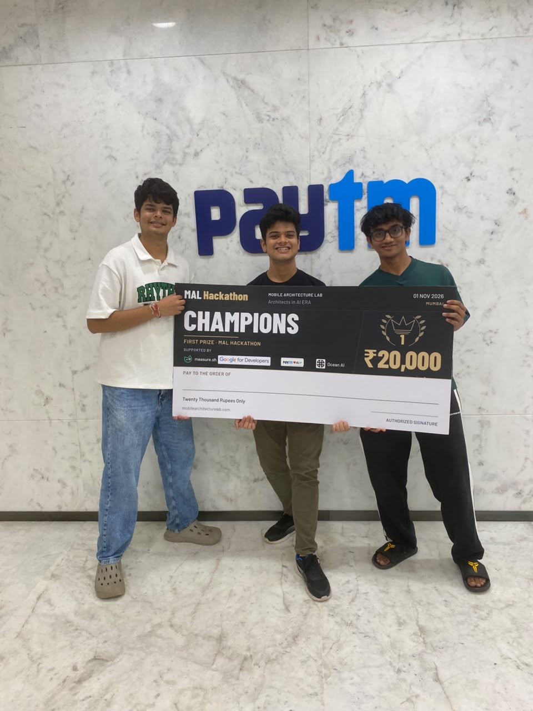

# NeuroTechh - [BLOG HERE](https://jkartik.in/blog/mal4-hackathon-where-code-was-optional/)

**First Prize — Mobile Architecture Lab (MAL4) Hackathon 🏆**

A mobile appointment and patient-record platform connecting patients, hospitals and doctors in one app.

Built by [@KartikJain14](https://github.com/KartikJain14), [@naitiklodha](https://github.com/naitiklodha) and [@MananGandhi1810](https://github.com/MananGandhi1810).



*The team with the first-prize cheque. Mumbai, 1 November 2026.*

## Documentation

The design documents behind the win, with a record of where the code differs from them. Start at the [documentation index](docs/README.md).

| Document | What it covers |
| --- | --- |
| [Problem brief](docs/problem-brief.md) | The problem, users, scope and success conditions |
| [Production design](docs/architecture/production-design.md) | The full platform at scale: regions, compliance, payments and rollout |
| [High-level design](docs/architecture/hld.md) | The prototype's architecture, data flows and failure handling |
| [Low-level design](docs/architecture/lld.md) | The confirm flow: invariants, state machines, data model and concurrency |
| [Decision records](docs/adr/README.md) | 19 decisions, the alternatives to each, and what would reopen them |
| [As built](docs/architecture/as-built.md) | What the code does today, what has been verified, and known gaps |

## What it does

- **Patients:** discover hospitals and doctors, book appointments for themselves or family, attach medical records, manage appointments and access visit history.
- **Hospitals:** approve or decline requests, manage doctors and booking policies, upload hospital photos and scan QR passes for check-in.
- **Doctors:** manage weekly availability and individual time slots, review visits and records, and complete appointments with notes and prescriptions.
- **Patient records:** stored on the backend and retained across appointments, with records linked to relevant visits.

The interface uses Material components with a restrained red-and-white design, hospital galleries, cached navigation and skeleton loading states.

## Stack

| Layer | Technology |
| --- | --- |
| Mobile | React Native, Expo, Expo Router, React Native Paper |
| Data fetching | TanStack Query |
| Backend | Express, TypeScript |
| Storage | PostgreSQL |
| Sessions and caching infrastructure | Redis |
| Authentication infrastructure | Better Auth |
| Analytics infrastructure | ClickHouse |
| Mobile observability | Measure |
| Local services | Docker Compose |

The current app uses Patient / Hospital / Doctor role buttons and fixed development identities. Full authentication is deferred. ClickHouse integration is configured; analytics workflows remain pending. Concurrency, load, race-condition and security test suites are planned; see [testing backlog](docs/testing-backlog.md).

## Repository

```text
app/        Expo mobile application
backend/    Express API, SQL migrations and seed scripts
docs/       Design documents, decision records, implementation notes and testing backlog
compose.yaml
architecture.pdf   Scanned copy of the production design
```

## Run locally

Use Node.js 24 (`nvm use`), npm and Docker. Android builds also require an Android SDK and JDK 21. iOS builds require macOS and Xcode.

### Backend

```sh
docker compose up -d --wait
cd backend
npm ci
cp .env.example .env
```

Set `BETTER_AUTH_SECRET` in `backend/.env` to a unique value generated with `openssl rand -base64 32`. The example connection URLs match Compose; adjust them if your local ports differ.

```sh
npm run db:migrate
npm run db:seed
npm run dev
```

The API listens on `http://localhost:3000`. PostgreSQL, Redis and ClickHouse use Docker volumes for persistence. Compose credentials are local development defaults only.

### Android phone

Enable USB debugging, connect the phone and accept its authorization prompt.

```sh
cd app
npm ci
cp .env.example .env
adb reverse tcp:3000 tcp:3000
adb reverse tcp:8081 tcp:8081
npm run android
```

For subsequent sessions with the debug app already installed:

```sh
adb reverse tcp:3000 tcp:3000
adb reverse tcp:8081 tcp:8081
npm start -- --localhost
```

Open the installed development app and select the local server. Keep USB connected for forwarding. Set `EXPO_PUBLIC_API_URL` to `http://localhost:3000` for this setup. For LAN access, use your computer's reachable IP instead.

### iOS

From `app/`, run `npm run ios`. Configure the API URL for the simulator or connected device. The Measure integration requires a native development build rather than Expo Go.

### Measure

Set the appropriate `MEASURE_ANDROID_*` or `MEASURE_IOS_*` values in `app/.env` using your Measure project settings. Rebuild the native app after changing plugin configuration. No automatic test crash is enabled.

## Checks

```sh
cd backend
npm run typecheck
npm run build
```

```sh
cd app
npm run typecheck
npm run lint
```

## Configuration and secrets

Copy `.env.example` files locally; never commit populated `.env` files. Git ignores environment files, signing keys, native build output, logs and local tooling state. Public Expo variables and mobile SDK configuration are included in the app bundle: never place backend credentials in them.

Before publishing, review `git status` and the staged diff. Use separate deployment credentials and rotate any credential previously shared or committed. Ignoring a file does not remove it from existing Git history.

See [implementation notes](docs/implementation.md) for detailed workflows and current limitations.
