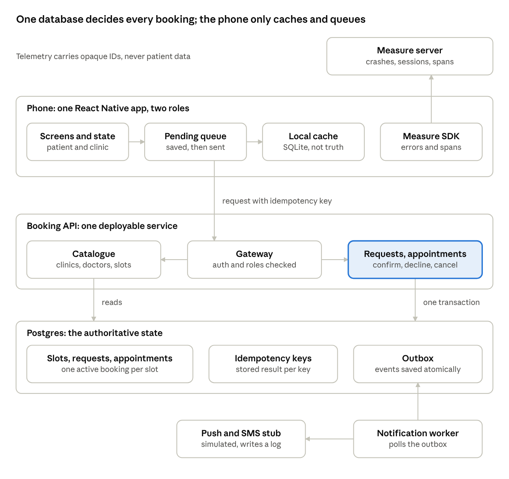
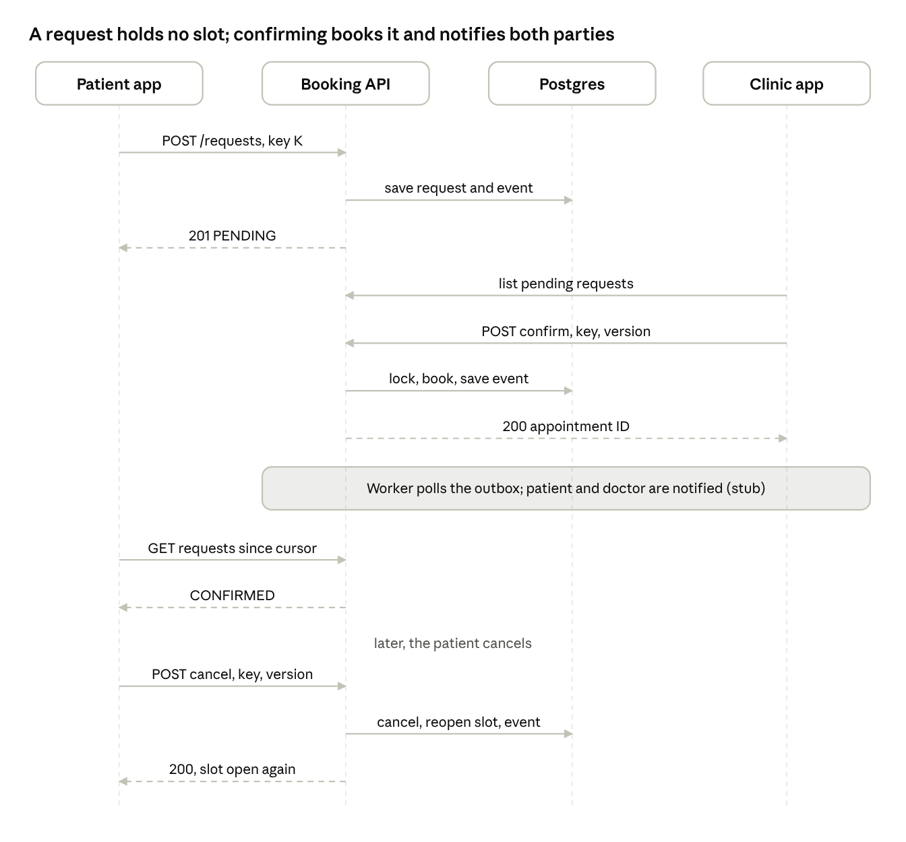
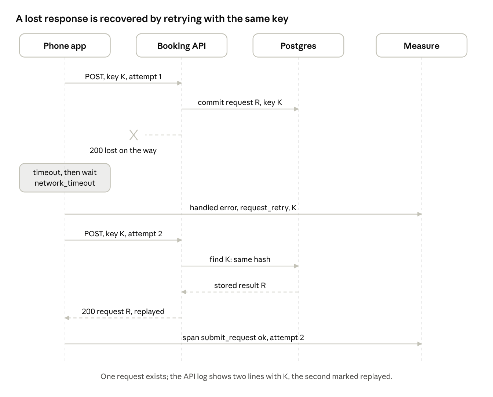
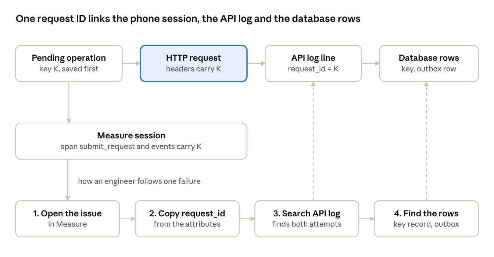

# NeuroTechh: High-Level Design (HLD)

> Written on 1 November 2026, before the code, as the design for the hackathon prototype. The design is kept as written. Notes marked **As built** say where the code differs, and [as-built](as-built.md) has the full comparison. The original is [high-level-design.pdf](../hackathon-submission/high-level-design.pdf).

## Overview

NeuroTechh lets patients request appointments in a mobile app and lets clinics confirm or decline them. The rule the whole design protects: a confirmed slot can never go to two patients. The design is one app, one deployable API and one authoritative database, with every claim marked as proposed or verified. The diagrams are the design, and [the status table](#what-is-simulated-and-what-is-verified) records what has since been verified.

**Scope.** Patients browse slots, request one, and see its status. Clinics confirm or decline. Either side can cancel; a patient can reschedule. Patient and doctor are told at each stage. Out of scope: sign-in screens, real payments, and real SMS or push delivery, which are simulated.

> **As built.** The app has a third role for doctors, and hospitals can also reschedule. Nobody is told yet: events are saved but not delivered, not even to a stub.

### The three priority attributes

| Attribute | Target | Decision | Evidence | Tradeoff |
| --- | --- | --- | --- | --- |
| Correctness and consistency | With 50 simultaneous confirms on one slot, exactly one appointment is confirmed and the rest are rejected with a clear reason | The database decides: a row lock plus a unique index allowing one active appointment per slot | Concurrent-confirm test; a check that no slot has two active appointments | Confirms on the same slot queue briefly behind each other |
| Reliability and recovery | A submit whose response is lost, or whose app is killed mid-send, creates exactly one request | The app saves a pending operation with an idempotency key before sending; the API returns the stored result when the key repeats | Lost-response simulation, traced end to end | Extra storage and duplicate handling, and a retention window for keys |
| Observability | Any failed action can be traced from the phone session to the API log and the database in five minutes, with no patient data in telemetry | One request ID travels with the action; Measure records the phone side | A forced failure found by its ID in all three places | A third-party SDK on the device, which adds a privacy surface |

Security and privacy are covered in their own section, not as a fourth attribute.

> **As built.** Correctness holds at the 50-confirm target, with [one known gap](as-built.md#known-gaps) for completed visits. Reliability is built on the server only: the phone does not save the operation first. Observability is limited to initialising Measure.

## System architecture

The database is the only place that decides whether a slot is taken. The phone caches and queues; the API applies the rules; notifications and telemetry travel on their own paths. The highlighted box is the feature examined in the [LLD](lld.md).

*System architecture · phone, one API, one database, simulated notifications, Measure for telemetry*

| Component | Responsibility | Authoritative state? |
| --- | --- | --- |
| Patient and clinic app | Screens, a read cache, a queue of operations not yet sent. One codebase; the role comes from the signed-in account. | No. The cache is a copy and the queue is a to-do list. |
| Booking API | Checks role and tenant, applies the business rules, changes state, and writes the event that tells people about it. | No. It decides, then writes to the database. |
| Postgres | Slots, requests, appointments, idempotency keys and the outbox. | Yes. The only source of truth. |
| Notification worker and stub | Reads the outbox and tells the patient and the doctor at each stage. | No. Simulated: the stub writes to a log and sends nothing. |
| Measure SDK and server | Crashes, errors, sessions and timings from the phone. | No. Optional. |

> **As built.** The app has no pending queue or SQLite cache; TanStack Query caches reads in memory. The role comes from demo buttons. There is no notification worker or stub. Redis and ClickHouse run beside the API but take no part in booking.

## Core journey

The sequence shows the whole journey as messages. Solid arrows are calls and dashed arrows are replies; K is the idempotency key the phone creates before sending.

*Core journey · request, confirm, notify, cancel as one sequence*

1. **Request.** The app saves a pending operation, then sends it. The API stores a PENDING request and an outbox event in one transaction. No slot is held, so several patients can ask for the same slot.
2. **Confirm.** The clinic lists its pending requests and confirms one. One transaction locks the slot, books it and saves the event. This is the step the LLD examines in depth.
3. **Notify.** A worker polls the outbox and tells the patient and the doctor. Delivery is simulated.
4. **Status.** The patient's app fetches changes since its last cursor and shows the appointment.
5. **Cancel.** One transaction cancels the appointment, reopens the slot and saves the event, so the slot can be confirmed for someone else.

> **As built.** Steps 1, 2 and 5 work as described on the server, using [different routes](as-built.md#http-api). Step 3 stops at the saved event. Step 4 refetches the whole list instead of using a cursor.

## Data flows, boundaries and who owns state

### Data flows

| Flow | Path | What crosses the boundary | Notes |
| --- | --- | --- | --- |
| Browse | App, API (Catalogue), Postgres, back | One day of slots for one clinic, with a last-updated time | Cached on the phone; never shown as current when stale |
| Request | Pending queue, API, Postgres | Slot ID and idempotency key K | Creates a PENDING request; holds no slot |
| Confirm or decline | Clinic app, API, Postgres | Request ID, version, key | One transaction; the event is saved with the change |
| Status | API, app | Changes since a cursor | Pulled on open and when a simulated push arrives |
| Cancel and reschedule | App, API, Postgres | Appointment ID, version, key | Cancel reopens the slot in the same transaction; a reschedule is a new request that replaces the old appointment only when confirmed |
| Notification | Outbox, worker, stub | An event with IDs only | Delivery is simulated |
| Telemetry | SDK, Measure server | Request ID, outcome, screen, role | Separate path; no patient data |

### Who owns which state

| Data | Owner | Copies | If copies disagree |
| --- | --- | --- | --- |
| Slot status, requests, appointments | Postgres | The phone's cache | The database wins; the cache is replaced on the next fetch |
| Operations not yet sent | The phone's pending queue | None | The queue is the only record until the API confirms it |
| Idempotency results | Postgres | None | Return the stored result |
| Events to deliver | The outbox in Postgres | The log written by the stub | The outbox is truth; the stub only reports |
| Telemetry | Measure | None | Never used to decide anything |

**Trust boundaries.** The app is untrusted: every rule is enforced in the API, and the role and clinic come from a signed token, not from a request field. A clinic user can act only on slots belonging to their own clinic, and a patient only on their own requests. The database is reached only by the API. The notification stub is the only external system, and it is simulated.

> **As built.** The rules are enforced in the API and the database, but the role comes from the `X-Demo-Role` request header in development, because sign-in is deferred. That header is ignored when `NODE_ENV=production`.

## Failure and recovery

The failure to demonstrate: the API commits the request, but the response never reaches the phone.

*Failure and recovery · lost response, retry with the same key, one request*

The retry returns the first result because the API stored it against the key with a hash of the payload. If the same key arrives with different content, the API rejects it as `IDEMPOTENCY_CONFLICT`. If the app is killed after the commit, the same recovery happens on the next launch, because the saved operation is still marked as sending. The demonstration drops the response with a test proxy; that is a simulation and is labelled as one.

**Retry rules.** The app retries only what can succeed on a retry: a timeout or a server error, with growing delays and at most five attempts. A rejection by the rules (409 or 422) is final and is shown to the user. Both numbers are proposals to tune.

> **As built.** The server half is verified: repeating a key returns the stored result, and reusing it with different content returns `409 IDEMPOTENCY_KEY_REUSED`. The phone half is not built. The key is held in memory, so it is lost if the app is killed, and retrying is a manual second tap. The test proxy has not been built.

### What each feature does when the API is down

| Feature | State | Behaviour |
| --- | --- | --- |
| Browse slots | Read-only | Shows cached slots with their last-updated time; never presented as current |
| Request | Queued | Saved on the phone and sent when the API is reachable; shown as "waiting to send" |
| Status | Read-only | Shows the last known status with its time |
| Confirm, decline, cancel | Stopped | These change the authoritative state, so they need the API and say so |

> **As built.** Nothing is queued: a request made while the API is down fails with an error message. Reads come from the in-memory cache while the app stays open, without a last-updated time.

## Observability and error tracing with Measure

The app creates a request ID K when it saves a pending operation. K is the idempotency key and the trace key. It travels in the `Idempotency-Key` and `X-Request-Id` headers, appears in every API log line, sits on the outbox event, and is attached to the Measure span and events on the phone. The dashed arrows show that steps 3 and 4 of an investigation land on the same K.

*Observability · one request ID from the phone session to the database rows*

**Why the Measure SDK ([measure.sh](https://measure.sh)) is used.** The failures this app most needs to explain leave no trace on the server: a lost response, an app killed mid-send, a stale cache. Only the device saw the tap, the timeout and the retry. Measure records a session timeline of screens, taps, network calls, logs and lifecycle events and attaches it to crashes and errors. It is open source (Apache 2.0), built for React Native, and can be self-hosted. It also makes the correctness rule observable: a rejected confirm and a retried submit become countable events with a request ID. In the hackathon rubric, testing and observability carried 15% of the score, and the SDK was an optional bonus that counted only if it was integrated and produced real measurements.

What was checked in Measure's own documentation on 1 Nov 2026:

- **Install.** `npm install @measuresh/react-native@0.4.2`; it needs React Native 0.73 or later. On Expo, a config plugin plus `npx expo prebuild`. Initialise with `await Measure.init({ config: new MeasureConfig({}) })`, then verify with a deliberate test error.
- **Captured.** Crashes with stack traces and replay; unhandled errors including JavaScript errors and unhandled promise rejections; handled exceptions reported with attributes; ANRs on Android; spans; custom events; launch time. JavaScript source maps must be uploaded for readable traces.
- **Privacy defaults.** Request and response headers and bodies are not collected unless a URL is opted in, and Authorization and Cookie headers are always blocked. Screenshots are masked on the device. Replays are on by default only for fatal errors, and handled errors are sampled at 0% by default.
- **Not verified.** The exact React Native method signatures, whether Expo Go works (a development build is likely needed), the SDK's overhead on a device, and the names of the masking settings.

> **As built.** `app/src/lib/measure.ts` makes the `Measure.init` call above when `MEASURE_*` values are set, and the SDK needs a native development build rather than Expo Go. K is sent only as `Idempotency-Key`: there is no `X-Request-Id`, no API request logging and no custom Measure event or span. The test error was not added, and overhead and masking settings remain unverified.

### What may and may not go into telemetry

| Allowed | Never allowed |
| --- | --- |
| Request ID, attempt number, outcome, HTTP status, screen name, role, opaque user ID | Names, phone numbers, emails, diagnoses, notes, free text, slot times, any body or header of a clinical request |

The outcome attribute separates a network failure from a rule rejection: `network_timeout`, `rejected_slot_taken`, `rejected_validation`, `server_error`, `ok`. Telemetry is switched off if the user opts out, and the consent text names diagnostic data.

### Alternatives

| Option | Strength | Why not here, or when to pick it |
| --- | --- | --- |
| Measure (chosen) | Built for React Native; open source; replay, spans and launch metrics together; self-hostable | A younger project; check release notes before upgrading |
| Firebase Crashlytics | Free and widely used | Closed source, data goes to Google, no self-hosting. Pick it if crashes alone suffice and that processing is acceptable. (working knowledge, unverified) |
| Sentry | Mature React Native SDK with tracing | Heavier to self-host. Pick it if the team already runs it. (working knowledge, unverified) |
| OpenTelemetry directly | Vendor neutral | Mobile support is less mature and a backend must be built. (working knowledge, unverified) |
| Logs only | No dependency | Nothing comes back from a phone that was killed; kept as the fallback behind the telemetry interface |

**Where it runs.** For the hackathon, Measure Cloud with synthetic data only. For production, self-host in the cell's region or sign a data-processing agreement; self-hosting is documented for a single Linux machine with at least 4 vCPUs, 16 GB of RAM and 100 GB of disk, with 32 GB or more recommended for ClickHouse. The SDK is now installed; the [LLD](lld.md#interfaces-and-http-contract) defines the interface the integration was meant to go behind, which has not been built.

**Performance evidence to collect.** The journey is: open the app, see slots, submit a request, see the status. On one named device and network, record cold launch time, the slot-list call latency and the `submit_request` span duration. If the slot list is unpaged or runs a query per row, fix it and repeat. No readings are recorded in this repository, and none should be quoted until they are.

## Security, privacy, scalability and cost

### Security and privacy controls

| Concern | Control | Where it is enforced |
| --- | --- | --- |
| Who may do what | Role and clinic come from a signed token; the clinic ID is part of every query | API, never the app |
| Data in transit | TLS from the app to the API; the database is reachable only from the API | Network and API |
| Data on the phone | The cache holds only what a screen needs, is encrypted, and is cleared on sign-out; the pending queue holds IDs, not clinical text | App |
| Logs and telemetry | IDs only, from an allowed list; no names, contact details or notes | App and API |
| Notifications | Generic wording with no clinical detail, since a lock screen is public | Worker |
| Accountability | Every state change records the actor, the time and the request ID | API, in the same transaction |
| Retention | Idempotency records are deleted after a retention window, for example 7 days | Scheduled job |
| Consent | Diagnostic telemetry can be switched off by the user and is named in the consent text | App |

These are the controls the prototype would demonstrate. Production controls such as key management, regional data residency and legal review are out of scope for the prototype and are described in the [production design](production-design.md).

> **As built.** The accountability record, retention job, telemetry opt-out and consent text are not built. Local runs use plain HTTP. See [as-built](as-built.md#design-differences).

**Scalability.** Paging a list does not prove scalability, so the workload and the bottleneck are stated. The workload figures are assumptions for sizing, not measurements.

| Workload (assumed) | Likely bottleneck | What changes at ten times the load |
| --- | --- | --- |
| Slot lists read by many patients; for example hundreds of reads per second at peak | Database reads on the slot table | An index on clinic and start time; a short-lived cache of the day's slots; read replicas if needed |
| Many patients confirming or requesting a popular slot | Lock wait on that one slot row | Contention stays per slot, so other slots are unaffected; if one slot becomes hot, put admission control in front of the database |
| Outbox polling by the worker | Polling cost and delivery lag | Batch size and poll interval; more workers reading disjoint batches |
| API instances | CPU per instance | Run more copies; the API keeps no state of its own |

**Cost and operability.** One deployable service and one database keep the running cost and the on-call surface small. Rollback is a redeploy of the previous API version; schema changes follow an expand-then-contract rule so that the previous version still works. The database is backed up with point-in-time recovery, and the recovery is rehearsed. Measure is the only extra service, and it is optional.

## Assumptions and decision records

**Assumptions.** Each one is stated so it can be challenged.

- Sign-in is out of scope. The role and clinic come from a signed token issued by a stub, and the API trusts only the token.
- A doctor's slots do not overlap; the clinic app prevents it when slots are created.
- Times are stored in UTC and shown in the clinic's time zone.
- Clinic staff have a good connection; patients may not.
- Numbers in this pack are proposals to tune, not measurements: five retry attempts, a seven-day key retention, and requests expiring when the slot starts.
- All data is synthetic. No real patient data enters the system or the telemetry.

### What is simulated, and what is verified

This table is updated from the original, which was written before any code existed. Details and evidence are in [as-built](as-built.md#invariants).

| Item | Status |
| --- | --- |
| Booking rule under concurrency | Verified on Postgres. The test suite covers 2 concurrent confirms; a one-off probe also covered 50 and 200, and each gave exactly one confirmed appointment. |
| Replay and key reuse | Verified at the API |
| Lost response | Not run. The test proxy does not exist, and the phone does not save the operation first. |
| Notifications | Not built. Events are saved to the outbox, but no worker or stub reads them. |
| Observability and telemetry rules | Not built, beyond initialising the SDK |
| Measure facts | Read from Measure's documentation on 1 Nov 2026. Expo Go was ruled out by the integration; custom-event signatures, overhead and masking settings are unverified. |
| Performance and load | Not measured |

### Key decisions

These two summaries sit beside the design they govern. The full records, with all the other decisions, are in the [ADR index](../adr/README.md). The original PDF numbers them ADR 1 and ADR 4, which does not match the index.

**One deployable API and one database, not microservices** (see [ADR-001](../adr/001-one-modular-api.md) and [ADR-002](../adr/002-postgres-single-source-of-truth.md)).

- **Context.** Confirming must change a slot, a request, an appointment and an outbox event together. Extra services earn no credit by themselves.
- **Alternatives.** A service per capability (requests, appointments, catalogue, notifications) coordinated by a saga; serverless functions over a managed database.
- **Decision.** One API with enforced module boundaries, and one Postgres database.
- **Consequences.** The rule needs one local transaction, not a saga whose gaps could double-book a slot. The API still scales out by running more copies. The cost is that modules share a deployment, so boundaries must be kept by tests and review.
- **Revisit when.** A part needs a different failure or scaling profile, such as notification delivery against slow providers. The first candidates to extract are notification delivery, file handling, search indexing and audit anchoring.

**The Measure SDK sits behind a Telemetry interface** (see [ADR-003](../adr/003-dependencies-point-inward.md) and [ADR-017](../adr/017-hosted-measure.md)).

- **Context.** Error tracing is wanted on the device, but a monitoring SDK is a dependency and a privacy surface.
- **Alternatives.** Call the SDK directly from screens; no device telemetry; another vendor.
- **Decision.** The app imports only `Telemetry`; one file adapts Measure, and tests use a fake.
- **Consequences.** The SDK can be replaced in one file, the allowed attributes are enforced in one place, and tests can assert that nothing forbidden is sent. The cost is a thin layer to maintain.
- **Revisit when.** The SDK's API or privacy controls change enough to make the layer misleading.

The decisions about the database rule and the idempotency key are in the [LLD](lld.md#a-requirement-change-and-decision-records), next to the algorithms they govern.
