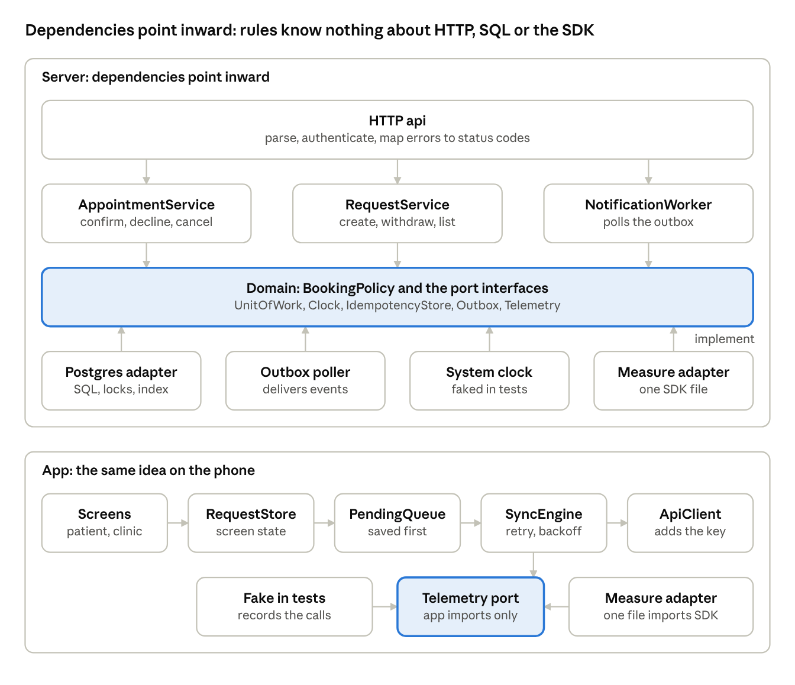
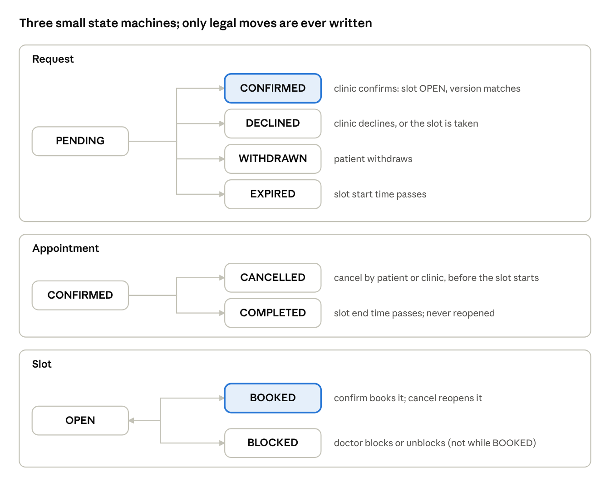
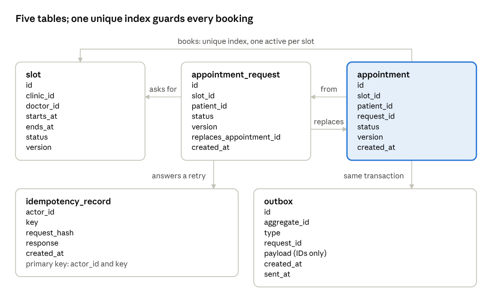
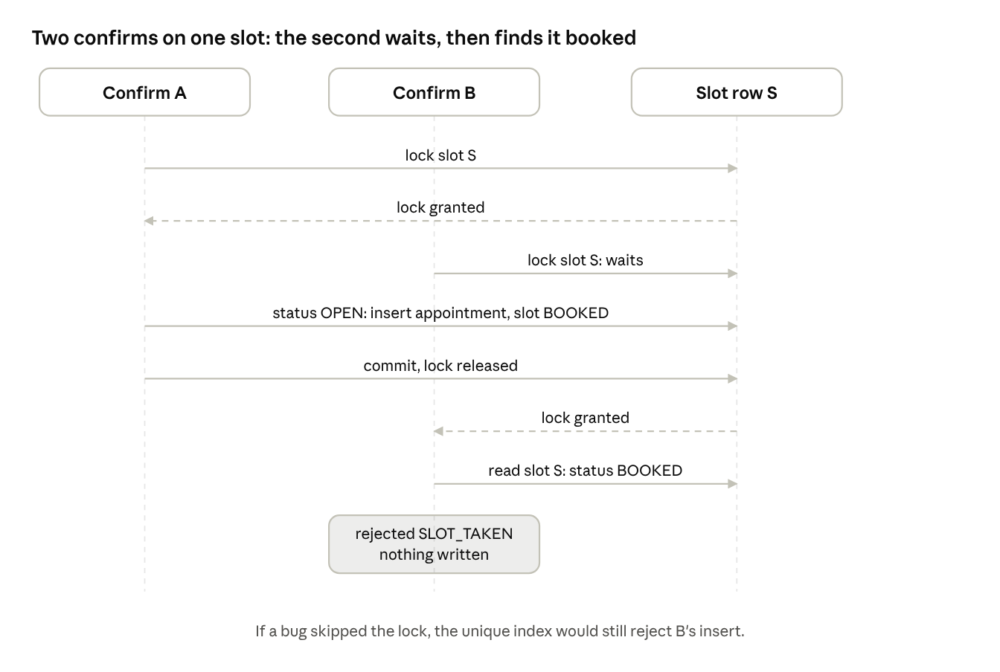

# NeuroTechh: Low-Level Design (LLD)

Nov 1, 2026 · @Kartik Jain

> Written before the code, as the companion to the [HLD](hld.md). The design is kept as written. Notes marked **As built** say where the code differs, and [as-built](as-built.md) has the full comparison, including [the real API](as-built.md#http-api) and [schema](as-built.md#data-model). The original is [low-level-design.pdf](../hackathon-submission/low-level-design.pdf).

## Scope and invariants

The feature examined in depth is **a clinic confirms a pending request**. It holds the business rule, the concurrency, the retry and the notification, and it creates the state that a cancel must later undo exactly. This document takes the HLD's components down to modules, interfaces, models and state transitions for this one feature. The tests in this document began as a plan; [the test plan](#test-plan) now records which have run.

### Invariants

| ID | Rule | Enforced by | Test that would catch a break |
| --- | --- | --- | --- |
| I1 | A slot has at most one active appointment | A partial unique index on the appointment table; the confirm also locks the slot row | Fifty simultaneous confirms on one slot |
| I2 | A pending request holds no slot | Only confirm changes a slot's status; creating a request never does | Several patients request the same slot |
| I3 | Cancelling reopens the slot consistently | The appointment and the slot change in the same transaction, guarded by version numbers | Confirm, cancel, then a new patient confirms the same slot |
| I4 | A retried command has the same effect as one attempt | An idempotency record keyed by actor and key, with a hash of the payload | Send the same confirm twice; reuse a key with a different payload |
| I5 | Only legal state changes happen | One transition table, checked in the domain code before any write | Confirm an already declined request |
| I6 | A clinic acts only on its own slots | The clinic ID is part of every query, not a check afterwards | Clinic B confirms a request for clinic A |

> **As built.** All six hold, some by different means, with one gap: I1's index does not cover `completed`, so [completing a future visit reopens its slot](as-built.md#known-gaps). See [invariants as built](as-built.md#invariants).

## Module structure

The rules sit at the centre and depend on nothing. The HTTP layer and the services call inward; the adapters (SQL, outbox, clock, SDK) implement the port interfaces from outside. This is dependency inversion: the booking rules can be tested with a fake repository and a controlled clock, and the database or the SDK can change without touching them.



*Module structure · server and app, dependencies pointing inward*

| Module | Responsibility | Depends on |
| --- | --- | --- |
| `api` | Parse the call, authenticate, map a result to an HTTP status and error body | `AppointmentService`, `RequestService`, `Telemetry` |
| `BookingPolicy` (pure) | The transition table, and the rule for a request's first status (manual confirm now, auto-confirm later) | Nothing |
| `AppointmentService` | Confirm, decline and cancel, each as one unit of work | `BookingPolicy`, `UnitOfWork`, `Clock` |
| `RequestService` | Create, withdraw and list requests since a cursor | `BookingPolicy`, `UnitOfWork`, `Clock` |
| `UnitOfWork` and repositories | One transaction, the locks, and the SQL | The database only |
| `IdempotencyStore` | Find or save the result for an actor and key | Inside the same transaction |
| `Outbox`, `NotificationWorker` | Save an event with the change; later deliver it | The database, and the notification port |
| App: `RequestStore` | Screen state for requests | `PendingQueue`, local cache |
| App: `PendingQueue`, `SyncEngine` | Save an operation before sending it; send it with its key; retry with bounded backoff; stop on a rejection | `ApiClient`, `Telemetry`, `Clock` |
| App: `Telemetry` port | The only telemetry type the app imports | Measure adapter, or the fake in tests |

> **As built.** None of these modules exist under these names. Rules and SQL sit together in the route handlers in `backend/src/modules/bookings.ts` and `workflows.ts`, and `app/src/lib/api.ts` is the app's API client. See [ADR-003](../adr/003-dependencies-point-inward.md).

## State machines

Each record has its own small machine. The two highlighted states are the ones that carry the business rule: a request becomes CONFIRMED only together with its slot becoming BOOKED. Arrows with a head at both ends are reversible moves.



*State machines · request, appointment and slot, with the events that move them*

| Record | From | Event | Guard | Effect |
| --- | --- | --- | --- | --- |
| Request | PENDING | Clinic confirms | Slot is OPEN, the version matches, the clinic owns the slot | CONFIRMED; appointment created; slot BOOKED |
| Request | PENDING | Clinic declines, or the job after another confirm | Version matches | DECLINED; patient told |
| Request | PENDING | Patient withdraws | Patient owns it | WITHDRAWN |
| Request | PENDING | Slot start time passes | Clock says so | EXPIRED |
| Request | any other state | Confirm or decline | None | Rejected as `NOT_PENDING`; nothing changes |
| Appointment | none | Confirm | As above | CONFIRMED |
| Appointment | CONFIRMED | Cancel by patient or clinic | Before the slot starts; version matches | CANCELLED; slot OPEN again; both told |
| Appointment | CONFIRMED | Slot end time passes | Clock says so | COMPLETED; the slot is never reopened |
| Slot | OPEN | Confirm | Inside the unit of work | BOOKED |
| Slot | BOOKED | Cancel | Inside the unit of work | OPEN |
| Slot | OPEN | Doctor blocks it | No active appointment | BLOCKED |
| Slot | BOOKED | Doctor blocks it | Not allowed | Rejected: cancel the appointment first |

**Reschedule.** A reschedule is a new request for another slot, carrying `replaces_appointment_id`. Confirming it books the new slot and cancels the old appointment in the same transaction. If the new request is declined or expires, the patient keeps the old appointment.

> **As built.** One appointment row carries both lifecycles, and slots have no status column. See [the real transitions](as-built.md#appointment-states). Reschedule works as described for patients, using `previous_id`.

## Data model

The appointment table is highlighted because it carries the rule: a partial unique index allows only one active row per slot, whatever the application code does. The idempotency record and the outbox row are written in the same transaction as the change they describe.



*Data model · five tables and how they relate*

```sql
-- I1: the last line of defence for the booking rule
CREATE UNIQUE INDEX one_active_appointment_per_slot
    ON appointment (slot_id) WHERE status IN ('CONFIRMED', 'COMPLETED');
```

| Record | Notes |
| --- | --- |
| `slot` | Times stored in UTC, with the clinic's time zone kept beside them for display. `version` rises on every change and guards against stale writes. |
| `appointment_request` | `replaces_appointment_id` is what makes a reschedule safe. `status` is one of PENDING, CONFIRMED, DECLINED, WITHDRAWN, EXPIRED. |
| `appointment` | One active row per slot (I1). `status` is CONFIRMED, CANCELLED or COMPLETED. |
| `idempotency_record` | Deleted after a retention window, for example 7 days. The hash of the payload lets a reused key with different content be rejected. |
| `outbox` | The payload carries IDs, never names or clinical text. `sent_at` is empty until the worker has delivered the event. |

> **As built.** The code merges the request and appointment tables and indexes `confirmed` only. See [the schema mapping](as-built.md#data-model).

## Confirm and concurrency

Two clinic users confirm different requests for the same slot at the same moment. The lock makes them take turns, and the second one then reads the slot's new status. The unique index from the data model is the backstop if the lock is ever skipped.



*Concurrency · two simultaneous confirms on one slot*

**The confirm, step by step.** The order of the locks is fixed (slot first, then request), and a reschedule locks the two slots in ascending ID order, so two transactions can never wait on each other.

```text
confirm(actor, requestId, cmd):
  require actor.role == 'clinic'
  unitOfWork.run(tenant, tx):                            -- one database transaction
    prior = tx.idem.find(actor.userId, cmd.idempotencyKey)
    if prior: return prior.hash == hash(requestId, cmd) ? prior.response : rejected(IDEMPOTENCY_CONFLICT)
    req  = tx.requests.get(requestId)                    -- to learn which slot to lock
    slot = tx.slots.lockForUpdate(req.slotId)            -- SELECT ... FOR UPDATE
    req  = tx.requests.lockForUpdate(requestId)          -- re-read under the lock
    if req.status != PENDING:           return rejected(NOT_PENDING)
    if req.version != cmd.expectedVersion: return rejected(STALE_VERSION)
    if slot.clinicId != actor.clinicId: return rejected(FORBIDDEN)
    if slot.status != OPEN:             return rejected(SLOT_TAKEN)
    appt = tx.appointments.insert(slot, req.patientId, CONFIRMED)   -- the unique index is the backstop
    tx.requests.set(req, CONFIRMED); tx.slots.set(slot, BOOKED)
    if req.replacesAppointmentId: cancel the old appointment and reopen its slot (slots locked in id order)
    tx.outbox.add('appointment_confirmed', requestId)
    tx.idem.save(actor.userId, cmd.idempotencyKey, hash, response)
  on unique violation: return rejected(SLOT_TAKEN)
  after commit: schedule decline_siblings(slot)          -- retried until it succeeds
```

The other requests for the slot are declined by a retried job after the commit. That is safe because the slot is already booked: any confirm attempt on them fails with `SLOT_TAKEN` until the job has run.

> **As built.** `bookings.ts` follows this order (idempotency, slot lock, appointment lock, checks, write), with an advisory lock around retries of one key. It declines siblings inside the transaction, so the loser of a race receives `STALE_VERSION`, not `SLOT_TAKEN`: its own request has already been declined and its version raised. Reschedules do not lock slots in ascending order. See [as-built](as-built.md#design-differences).

The original design allowed for a simulated demo backend, such as SQLite inside the app process, and warned that it would not prove the rule under production concurrency, because SQLite serialises writers instead of locking rows. The prototype did not need that fallback: it runs on Postgres from `compose.yaml`, and the locks and indexes above are the real ones.

## Interfaces and HTTP contract

Written in TypeScript for readability. These are the design's interfaces; they do not exist in the code.

```ts
type RequestStatus = 'PENDING' | 'CONFIRMED' | 'DECLINED' | 'WITHDRAWN' | 'EXPIRED';
type AppointmentStatus = 'CONFIRMED' | 'CANCELLED' | 'COMPLETED';
type SlotStatus = 'OPEN' | 'BOOKED' | 'BLOCKED';

interface Actor { userId: string; role: 'patient' | 'clinic'; clinicId?: string }

interface Command { idempotencyKey: string; expectedVersion: number }
type Rejection = 'SLOT_TAKEN' | 'STALE_VERSION' | 'NOT_PENDING' | 'FORBIDDEN' | 'IDEMPOTENCY_CONFLICT';

type ConfirmResult =
  | { kind: 'confirmed'; appointmentId: string }
  | { kind: 'replayed'; appointmentId: string }    // same key, same payload: the stored result
  | { kind: 'rejected'; reason: Rejection };

interface AppointmentService {
  confirm(actor: Actor, requestId: string, cmd: Command): Promise<ConfirmResult>;
  decline(actor: Actor, requestId: string, cmd: Command): Promise<DeclineResult>;
  cancel(actor: Actor, appointmentId: string, cmd: Command): Promise<CancelResult>;
}

interface UnitOfWork { run<T>(tenantId: string, work: (tx: Tx) => Promise<T>): Promise<T> } // one transaction
interface Tx { slots: SlotRepo; requests: RequestRepo; appointments: AppointmentRepo; idem: IdempotencyStore; outbox: Outbox }
interface Clock { now(): Date }                     // fake in tests, so expiry is testable

// The only telemetry type the app imports
type Outcome = 'ok' | 'network_timeout' | 'rejected_slot_taken' | 'rejected_validation' | 'server_error';
interface Attrs { request_id: string; attempt?: number; outcome?: Outcome; http_status?: number; screen?: string; role?: 'patient' | 'clinic' }
interface Telemetry {
  init(): Promise<void>;
  event(name: string, attrs: Attrs): void;
  error(e: unknown, attrs: Attrs): void;
  span<T>(name: string, attrs: Attrs, work: () => Promise<T>): Promise<T>;
  setUser(opaqueId: string | null): void;
  setEnabled(on: boolean): void;
}
```

One file adapts the Measure SDK to `Telemetry`; tests use a fake that records calls. The SDK method signatures for React Native are unverified and must be checked against the package's types before the adapter is written.

### HTTP contract

| Call | Caller | Success | Rejections |
| --- | --- | --- | --- |
| `POST /requests` with `Idempotency-Key` and `X-Request-Id` | Patient | 201 with the request in PENDING; 200 with the same body on a replay | 409 `IDEMPOTENCY_CONFLICT`, 409 `SLOT_TAKEN` if the slot is no longer open, 422 invalid |
| `POST /requests/{id}/confirm` with `Idempotency-Key` and the request's version | Clinic | 200 with the appointment ID | 409 `SLOT_TAKEN`, `STALE_VERSION`, `NOT_PENDING`, `IDEMPOTENCY_CONFLICT`; 403 |
| `POST /requests/{id}/decline` | Clinic | 200 | 409 `NOT_PENDING`, `STALE_VERSION`; 403 |
| `POST /appointments/{id}/cancel` | Patient or clinic | 200, slot reopened | 409 `STALE_VERSION`, `NOT_CONFIRMED`; 403 |
| `GET /requests?since={cursor}` | Patient or clinic | 200 with the changes and a new cursor | 401 |

Every rejection has the same body: a code, a message safe to show, whether a retry could help, and the request ID. The app maps the code to a plain message and never shows raw server text. The app retries a timeout or a server error with growing delays, at most five attempts; a 409 or 422 is final and is shown to the user.

> **As built.** The API is under `/v1` with [different routes, codes and error bodies](as-built.md#http-api). The app does map codes to plain messages.

## Test plan

Each test names the invariant it protects. The original plan had no results; the last column is new.

**Suite** means `npm run test:integration` or `npm run test:workflows` in `backend/`. **Probe** means a one-off check against the real API on 1 Nov 2026, which is not in the repository and cannot be rerun. Details are in [as-built](as-built.md#how-this-was-checked).

| Test | Protects | Setup | Expected result | Status |
| --- | --- | --- | --- | --- |
| Concurrent confirm | I1 | Two requests for one slot; two clinic sessions confirm at once, repeated 50 times | One 200 and one 409 `SLOT_TAKEN` every time; one active appointment row | **Suite**, one race per run. **Probe**, 2, 50 and 200 at once. One winner each time; losers get `STALE_VERSION`. |
| Pending holds nothing | I2 | Five patients request the same slot | Five PENDING requests; the slot stays OPEN | **Suite** with two patients. **Probe** with five. |
| Replay | I4 | Send the same confirm twice with the same key | Same appointment ID both times; one appointment, one outbox event | **Suite** replays a request. **Probe** replays a confirm. |
| Key reuse | I4 | Same key, different request | 409 `IDEMPOTENCY_CONFLICT`; nothing changes | **Suite**. The code is `IDEMPOTENCY_KEY_REUSED`. |
| Stale version | I5 | The patient withdraws, then the clinic confirms with the old version | 409 `NOT_PENDING`; the slot stays OPEN | **Probe**. The code is `STALE_VERSION`. The suite covers a stale cancel. |
| Illegal transition | I5 | Confirm a declined request | 409 `NOT_PENDING`; nothing changes | **Probe** with a cancelled request. The code is `INVALID_STATE`. |
| Cancel reopens | I3 | Confirm, cancel, a second patient requests and is confirmed | Two appointment rows, one active; the slot goes BOOKED, OPEN, BOOKED | **Suite** up to the new request. **Probe** through the second confirm. |
| Wrong clinic | I6 | Clinic B confirms a request for clinic A | 403; nothing changes | **Probe**. The suite covers a non-staff user. |
| Crash mid-transaction | I1, I3 | Inject a failure after the insert and before the commit | No partial state: request, slot and appointment all unchanged | Not run |
| Expiry | I5 | A fake clock passes the slot start | The request becomes EXPIRED; a confirm is rejected | **Probe**, without a fake clock. The confirm is rejected, but the row stays `pending`. |
| Lost response | I4 | A proxy drops the response to a submit; the app retries | One request exists; the second call is marked replayed | Not run. There is no proxy, and replays carry no marker. |
| Telemetry | none | Run the rejection tests with the fake adapter | `rejected_slot_taken` is recorded with the request ID, and no attribute outside the allowed list appears | Not possible yet. The adapter does not exist. |

## A requirement change, and decision records

**A realistic change: clinics may confirm automatically.** The original brief allows an optional auto-confirm setting per clinic. It touches little because the rule lives in one place.

| Area | What changes | What stays |
| --- | --- | --- |
| `BookingPolicy` | Gains `initialStatus(clinicSettings)`, which says whether a new request starts as PENDING or goes straight to confirm | The transition table |
| `RequestService` | If the clinic auto-confirms, it runs the same confirm unit of work inside the create call | The confirm algorithm, the locks and the unique index |
| Data | One setting on the clinic record | Slot, request and appointment tables |
| Contract | `POST /requests` may return a request that is already CONFIRMED, or a 409 `SLOT_TAKEN` | Error body and idempotency rules; the app already handles every status |
| App | The status label; no pending-request reminder for clinics on auto-confirm | The pending queue and the sync engine |
| Tests | Add: two patients auto-confirm the same slot, one wins and the other sees `SLOT_TAKEN` | All existing tests, which must still pass |

> **As built.** Auto-confirm has not been built. This remains a worked example of how the design absorbs a change.

### Key decisions

These two summaries sit beside the algorithms they govern. The full records are in the [ADR index](../adr/README.md). The original PDF numbers them ADR 2 and ADR 3, which does not match the index.

**The database enforces the booking rule, with a row lock and a unique index, not a distributed lock** (see [ADR-005](../adr/005-partial-unique-index.md), [ADR-006](../adr/006-row-locks-in-fixed-order.md) and [ADR-011](../adr/011-no-redis-slot-locking.md)).

- **Context.** Two clinic users can confirm different requests for one slot at the same moment.
- **Alternatives.** A Redis lock around the confirm; check the slot in code and then insert; serializable isolation for every transaction.
- **Decision.** Lock the slot row for the transaction, check its status, and let a partial unique index reject any second active appointment.
- **Consequences.** Correct even if the application code has a bug, because the index is the final check, and no lock can expire in the middle of an operation. Confirms on the same slot queue briefly behind each other.
- **Revisit when.** A very popular slot makes that queue visible; optional admission control in front of the database can be added then.

**The phone creates the idempotency key and saves it with the pending operation** (see [ADR-012](../adr/012-phone-created-idempotency-keys.md) and [ADR-013](../adr/013-save-before-send.md)).

- **Context.** A response can be lost after the server has committed, and an app can be killed at any point.
- **Alternatives.** A server-generated ID returned in the response, which is lost with it; rely on a unique pair of patient and slot, which cannot tell a retry from a second deliberate request after a decline; retry with no key.
- **Decision.** The app generates the key before the first send, saves it, and reuses it for every retry. The API stores the result against the key with a hash of the payload.
- **Consequences.** A retry returns the first result, and a reused key with different content is rejected. The price is a key table with a retention window, and duplicate-handling code on both sides.
- **Revisit when.** The retention window turns out to be too long for storage or too short for real retry patterns.

The decisions about the single deployable and the telemetry interface are in the [HLD](hld.md#key-decisions).
