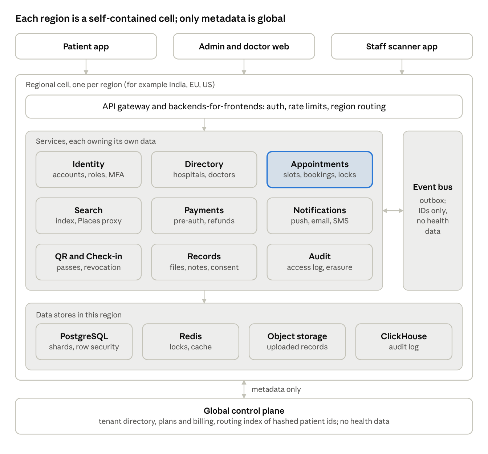
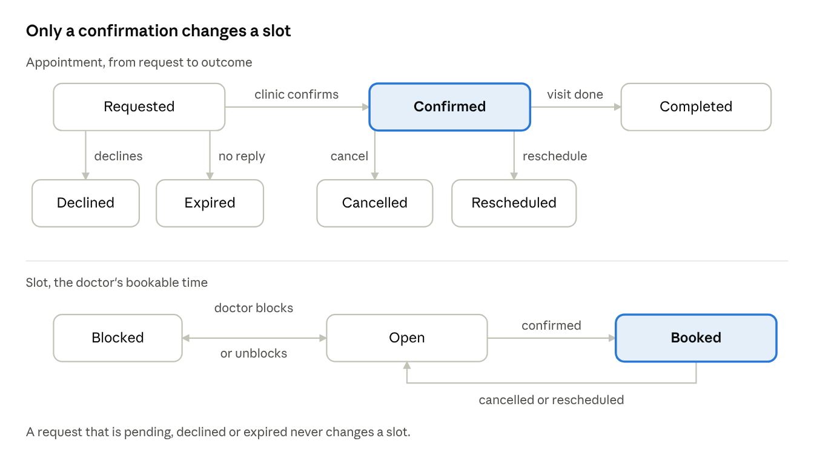
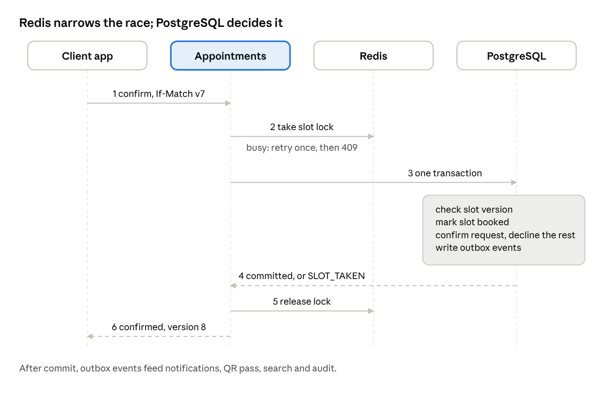
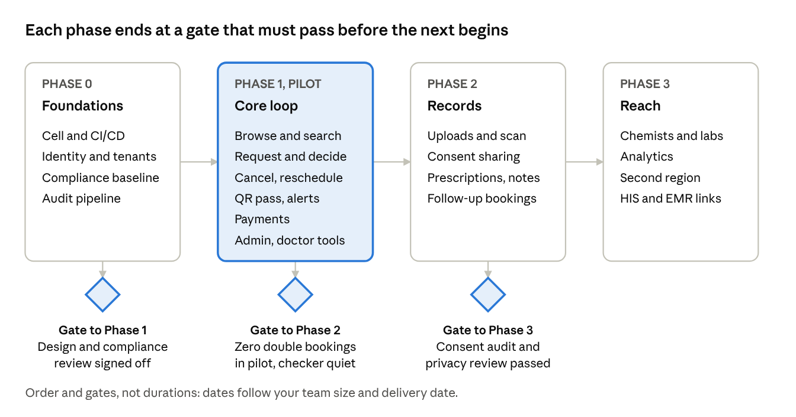

# Appointment Coordination Platform: Production Architecture

Nov 1, 2026 · @Kartik Jain

> **This is the long-term target, not the code.** It was written first, from the team's answers to scoping questions, and describes the platform at full scale. Very little of it has been built: the prototype in this repository is described by the [HLD](hld.md) and [LLD](lld.md), and [as-built](as-built.md) records what exists. The original is [production-architecture.docx](../hackathon-submission/production-architecture.docx), and [`architecture.pdf`](../../architecture.pdf) is a scanned copy of it.
>
> **Later decisions replace parts of it:**
>
> | This document says | Decided instead | Record |
> | --- | --- | --- |
> | Nine microservices on Kubernetes | One modular API and one database | [ADR-001](../adr/001-one-modular-api.md) |
> | Redis lock per slot, with fencing tokens | Postgres row locks and indexes only | [ADR-006](../adr/006-row-locks-in-fixed-order.md), [ADR-011](../adr/011-no-redis-slot-locking.md) |
> | Kafka event bus | Outbox with a polling worker | [ADR-014](../adr/014-transactional-outbox.md) |
> | ClickHouse audit log | Audit table in Postgres | [ADR-019](../adr/019-audit-log-in-postgres.md) |
> | Mutual TLS between services | TLS and signed tokens | [ADR-004](../adr/004-tls-and-signed-tokens.md) |
>
> The rest remains the reference for production concerns the prototype leaves out, such as regions, compliance, consent, payments and the rollout plan.

## Summary

We build a region-sharded, multi-tenant booking platform in which PostgreSQL alone decides who owns a slot, and approval by the clinic is the single point where competing requests are resolved.

The team's answers changed the contention model from the first assumption. Pending requests do not hold a slot, so many patients can ask for the same slot at once. The race therefore happens when a clinic approves, auto-confirms, reschedules or cancels, not when a patient taps Request.

### Headline decisions

- **Style:** microservices on Kubernetes, event-driven through a transactional outbox, one logical cell per region.
- **Slot integrity:** a Redis lock per doctor-slot reduces contention; a PostgreSQL partial unique index on confirmed bookings is the final guarantee; fencing tokens stop a stale lock holder from writing.
- **Flow:** request, then clinic confirm or decline (or per-clinic auto-confirm), then notifications and QR pass. No instant booking. Pending requests auto-expire and remind clinic admins.
- **Data:** PostgreSQL for transactional data, ClickHouse for audit logs, Redis for locks and caches, object storage for records, geohash cells for locality search.
- **QR:** an opaque signed token with no health data inside, cached offline on the phone and emailed as an image, revoked server-side on cancel or reschedule.
- **Payments:** now in scope, in both directions: hospitals pay the platform, and patients pay for appointments. [Conflicts and assumptions](#conflicts-and-assumptions) proposes the payment timing, which still needs confirming.
- **Compliance:** designed to the strictest common denominator (HIPAA, GDPR, India DPDP Act), with explicit patient consent for any cross-hospital sharing.

**Still needed:** the answers to the [open questions](#open-questions), mainly payment timing, the first launch region, and the MVP cut line. Everything else has a default so work can start.

## Conflicts and assumptions

Seven of the team's answers interact with each other or with the original brief; each is resolved below, and the last column marks what still needs confirming.

| Topic | What the answers imply | How this design resolves it | Confirm? |
| --- | --- | --- | --- |
| Records scope | The original brief excludes medical records; the team wants uploads, prescriptions and notes. | Treated as in scope. Records live in their own service and store, so the booking core can ship and be audited without them. | No |
| Pending requests | No slot hold while pending; several patients can request one slot; a clinic approves only one. | A slot has many pending requests but at most one confirmed booking. Approving one auto-declines the rest and notifies those patients. | Yes |
| Payments | Patients pay for appointments; hospitals pay the platform. | Card pre-authorisation at request, captured on confirm, released on decline or expiry, through a payment provider (no card data on our servers). Where pre-authorisation is unavailable, a pay-on-confirm link with a payment window. Hospital subscriptions run through a billing provider. | Yes |
| Reschedule after approval | Patients and hospitals can both reschedule or cancel after approval. | The old confirmed booking stays held until the new slot is confirmed, so nobody is ever left with neither. Auto-confirm clinics swap atomically. | Yes |
| Region sharding vs sharing | Data is sharded by region, but sharing across hospitals needs explicit consent. | A patient has one home region. Sharing inside a region is a consent grant. Sharing across regions is a consent-gated, time-limited, encrypted transfer. | Yes |
| Global compliance | One product, many laws; erasure rights conflict with mandatory medical retention. | A per-region policy engine sets retention, residency and consent rules. Erasure removes identity and non-mandatory data and retains what law requires, sealed. | Yes |
| Team size | The team chose microservices from day one; the team size is unknown. | Honoured. To keep it workable, this proposes about nine services on one shared platform template, not twenty. | Yes |

Smaller assumptions, made without asking: follow-up rules are per-doctor and optional (default unrestricted, since the answer was "flexible"); pending requests expire after a clinic-configurable window (default 24 hours) with reminders to admins before expiry; each clinic has a single time zone, and all times are stored in UTC.

## Actors and capabilities

Five actors use the platform; the first four are tenant users, and the fifth runs the platform itself.

| Actor | Surface | Core capabilities |
| --- | --- | --- |
| Patient | React Native app | Sign in with phone OTP, email or social login, plus biometrics. Manage dependents (child, parent). Browse and filter doctors, request, reschedule and cancel. Track status. Hold offline QR passes. Pay. Upload records and grant or revoke sharing. Find nearby chemists and labs. |
| Hospital admin | Web dashboard, plus mobile | Onboard and remove doctors. Set booking window, lead time, cancellation cutoff and auto-confirm. Approve or decline requests. Block dates. Cancel or reschedule confirmed bookings. Receive pending-request reminders. Manage staff and view billing. |
| Doctor | Web and mobile | Own weekly template and exceptions. Block slots separately for new and follow-up visits. View patient history the patient has shared. Post prescriptions and notes after a visit. Set follow-up rules. |
| Front-desk staff | Staff scanner (React Native) | Scan a QR pass, see the booking is valid, check the patient in, view today's list. |
| Platform super-admin | Internal console | Onboard tenants and regions, plans and billing, tenant health, support with audited break-glass access. |

Dependents are first-class: one patient account owns several patient profiles, and a guardian gives consent for a minor. This was chosen as the best option when the team left the question open, because retrofitting dependents later changes every table that stores a patient.

## Architecture style and principles

The platform is a set of regional cells, each a self-contained deployment, joined by a thin global control plane that holds no patient health data.

1. **The database is the authority; Redis only reduces contention.** A lost lock or a Redis outage must never produce a double booking. A PostgreSQL constraint is the last line of defence.
2. **Regional cells.** Each region (for example India, EU, US) runs its own Kubernetes cluster, PostgreSQL shards, Redis, ClickHouse and object storage. Patient and clinic data never leave their home region by default.
3. **Global control plane, no PHI.** It holds the tenant directory, plans and billing, region routing, and a patient-to-home-region index keyed by a hashed identifier.
4. **Tenant isolation inside a cell.** Shared schema with `tenant_id` on every row and PostgreSQL row-level security. A large hospital chain can be moved to a dedicated shard without code changes.
5. **Commands are synchronous, reactions are asynchronous.** Booking decisions return an answer immediately. Notifications, search indexing, audit and analytics consume events through a transactional outbox, so a booking and its event are committed together.
6. **Idempotency everywhere.** Every mutating call carries an idempotency key, so retries from flaky mobile networks cannot create duplicate requests or double charges.
7. **Consistent views by version.** Every booking and slot carries a monotonically increasing version. Patient and clinic screens render the same version; a write returns the new state so the writer sees it immediately (read-your-writes), and other viewers converge within seconds through push events.
8. **No health data in transit surfaces.** Events carry identifiers, not content. QR codes, emails, SMS and push payloads carry no diagnosis, specialty or record content.

## Service decomposition

Nine services, grouped by who owns the data, with scheduling and booking deliberately kept in one service so the slot constraint and the booking write share one database transaction.

*Regional cell architecture · 9 services. Clients enter through one gateway per cell. The Appointments service (highlighted) owns the slot ledger, and services share events, not tables. Only the control plane at the bottom spans regions, and it holds no health data.*

| Service | Owns | Responsibility | Primary store |
| --- | --- | --- | --- |
| Identity and Access | Accounts, sessions, roles, MFA | Sign-in (OTP, email, social, biometrics), staff and doctor accounts, RBAC plus per-tenant policies | PostgreSQL |
| Directory | Hospitals, branches, doctors, specialisations, booking policies, geohash | Onboarding, catalogue, per-hospital rules (booking window, cutoff, auto-confirm) | PostgreSQL |
| Appointments | Templates, exceptions, slot ledger, requests, bookings | Slot generation, request, approve, decline, reschedule, cancel, expiry, locking, outbox | PostgreSQL plus Redis |
| Search and Discovery | Search index, availability projection | Locality, specialisation and filter search; earliest-available ranking; nearby chemists and labs via a Google Places proxy | OpenSearch plus cache |
| Payments | Payment intents, refunds, hospital subscriptions | Pre-authorise, capture, release, refund; platform billing; ledger | PostgreSQL |
| Notifications | Templates, preferences, delivery log | Multilingual push, email and SMS; reminders and expiry nudges for clinic admins | PostgreSQL plus queue |
| QR and Check-in | Signing keys, pass records, revocation list | Issue and revoke passes, verify scans, record check-in | PostgreSQL plus Redis |
| Records and Consent | Uploaded files, prescriptions, notes, consent grants | Upload with virus scan, structured and free-text prescriptions, consent and sharing, access checks | PostgreSQL plus object storage |
| Audit and Compliance | Audit events, retention and erasure jobs | Immutable access and change log, data-subject requests, retention enforcement | ClickHouse plus archive |

Two edge components sit in front: an API gateway (authentication, rate limiting, region routing) and thin backends-for-frontends for the patient app and for the admin and doctor surfaces.

## Domain model and state machines

A request and its booking are one appointment record moving through states, and only the move into Confirmed changes the slot.

*Appointment and slot states · 2 lifecycles. A request can be declined, can expire, or can become the one confirmed booking for its slot. A confirmed booking ends as completed, cancelled or rescheduled, and the last two return the slot to open. The slot's own lifecycle has only three states, which is what keeps the guarantee simple to check.*

### Core entities

| Entity | Key fields | Notes |
| --- | --- | --- |
| Tenant | Region, time zone, booking policy (window, lead time, cancellation cutoff, auto-confirm, expiry) | A hospital or clinic; the policy belongs to the hospital, as the team specified |
| Doctor | Tenant, specialisations, languages, fee, visit durations for new and follow-up | Belongs to one tenant |
| Availability template and exceptions | Weekly pattern, blocked dates, extra hours, slot kinds allowed | The source that slots are generated from |
| Slot | Doctor, start and end in UTC, kind, status, version | The unit of contention |
| Patient profile | Account, name, date of birth, guardian link for dependents | One account can own several profiles |
| Appointment | Slot, patient profile, status, version, expiry, new or follow-up, previous appointment | Request and booking are one record |
| Pass | Appointment, status, key id | One active pass per confirmed appointment |
| Consent grant, record, prescription | See [the records section](#records-prescriptions-follow-ups-and-consent) | Kept in the Records service and linked by id only |

### Rules enforced by the database, not by code review

1. At most one confirmed appointment per slot: a unique index on the slot where the status is confirmed.
2. No overlapping confirmed appointments for one doctor: an exclusion constraint on doctor and time range, which also protects visits of different lengths.
3. Status changes only along the arrows above, through one stored function that also writes the outbox row.
4. Row-level security on `tenant_id` for every table.

## Competing requests and consistency

The database decides who gets a slot, and Redis only keeps most contenders from reaching it, so a lost lock can slow a booking down but cannot double-book it.

*Confirming a request under contention · 6 steps. The lock (step 2) lets one writer at a time work on a slot. The transaction (step 3) is still safe without it: it only succeeds if the slot still carries the version the caller saw, and the unique index rejects a second confirmed appointment for the same slot. A lock can expire mid-operation or vanish in a Redis failover, which is why the lock is never trusted alone.*

### Where races happen, and what resolves each

| Situation | What collides | Resolution |
| --- | --- | --- |
| Two patients request one slot at a manual-approval clinic | Nothing yet: both requests are stored as pending | The clinic confirms one; the same transaction declines the others and notifies them |
| Two admins, or an admin and the auto-confirm job, confirm different requests for one slot | Two writers for one slot | Lock narrows it; version check and unique index decide; the loser gets `SLOT_TAKEN` |
| Auto-confirm clinic, two patients tap Request together | The request is itself a booking attempt | Same path as above; the loser is shown nearby free slots |
| Clinic confirms while the patient withdraws or the request expires | One request, two status changes | Version check on the request row; exactly one change wins |
| Reschedule at a manual clinic | The old slot must stay held until the new one is confirmed | The new request stays pending while the old booking stays confirmed; confirming it swaps both in one transaction |
| Reschedule at an auto-confirm clinic | Two slots in one move | One transaction books the new slot and releases the old; if the new slot is lost, nothing changes |
| Cancel of a confirmed booking | Slot, pass and payment | One transaction sets the status, reopens the slot, revokes the pass and writes the outbox; refunds follow from the event |
| Doctor blocks a date with confirmed bookings | Slots and appointments | Preview first; then each affected appointment is cancelled with reason clinic and its slot blocked, in separate transactions, with patients offered new slots |
| A slow request outlives its lock | A stale holder | Harmless: its version is out of date, so the database rejects it |

**Consistent patient and clinic views.** The writer always gets the new state back in the response, so their own screen is right at once. Everyone else learns from events: the availability cache is cleared by the `SlotReleased` event and also expires on a short timer, and open screens refresh on push. The patient's booking list is a projection, so the app keeps the write response until the projection reaches the same version.

**Expiry and reminders.** A scheduled job moves requests to expired at the clinic's window (default 24 hours) using the same version check, so it cannot undo a confirmation made a moment earlier. It also reminds clinic admins part-way through the window; the default is at the halfway point and again near the end.

**Requests for a freed slot.** A cancelled slot goes straight back to public availability, as the team decided, with no waiting list. Requests that were declined when the slot was first confirmed stay declined; those patients can request the slot again once it reopens.

## Data architecture

PostgreSQL holds every fact that must be correct, and every other store is either derived from it or protects it. Each regional cell runs its own copy of all five stores below.

| Store | Holds | Why this store | Rules |
| --- | --- | --- | --- |
| PostgreSQL | Tenants, doctors, templates, slots, requests, bookings, payments, consent, prescription metadata | Transactions, constraints and row-level security give us the slot guarantee and tenant isolation | `tenant_id` on every row; one database schema per service; no cross-service joins |
| Redis | Slot locks, idempotency keys, rate limits, availability cache, QR revocation set | Sub-millisecond access for contention control | Never the source of truth; every key has a TTL; losing all of Redis loses speed, not data |
| ClickHouse | Audit events: who viewed or changed what, and when | Cheap, fast append and query over billions of rows | Append-only; monthly partitions; ordered by tenant, patient, time |
| Object storage | Uploaded records, prescription PDFs, QR images | Durable, cheap, per-object encryption | Two buckets: quarantine and clean; versioning on; no public access |
| Search index | Doctor and hospital catalogue with a projection of next free slots | Geo, text and filter queries that PostgreSQL would serve slowly at scale | Rebuilt from events; stale by seconds at most |

**Slot ledger.** A background job materialises concrete slot rows for each doctor across the hospital's booking window, from the weekly template plus exceptions. Each slot row carries status (open, booked, blocked), a kind (new or follow-up) and a version counter. Pre-materialised rows give the database something to lock and constrain; computing free time on the fly would not.

**Sharding.** The unit of sharding is the hospital (tenant), because the slot guarantee needs the slot, the request and the booking in one database transaction. Within a region we start with one primary and read replicas, and split large tenants to their own shard when needed. The patient's "my bookings" screen spans hospitals, so it reads from a patient-keyed projection that events keep current.

**Locality search.** Each hospital stores a geohash at precision 6 (cells of roughly 1.2 km by 0.6 km). A search computes the user's cell and its eight neighbours, widens to precision 5 when results are thin, then ranks by true distance and earliest free slot. Typed areas and pincodes resolve to a point first.

**Audit log integrity.** ClickHouse is not tamper-proof on its own. Each hourly batch is hashed and chained to the previous batch, and the hash is written to an object-lock (write-once) bucket, so any later edit is detectable.

## Notifications, QR passes and offline access

A QR pass proves that a booking exists and is still valid; it proves nothing else and contains nothing readable. The hospital scanner always asks the server, which is why cancelling a booking invalidates a pass the patient already emailed.

### Pass design

1. The token is opaque: a random pass id, a key id and a signature, with no name, doctor, specialty or time inside.
2. The pass is issued when the clinic confirms, and shown in the app, saved on the phone and emailed as an image.
3. The scanner sends the token to the QR service. The service checks the signature, that the pass is active, that the booking is confirmed, that today falls in the allowed window around the slot, and that the scanning staff belong to the same hospital.
4. On success the scanner shows the patient's display name, doctor and time, and records a check-in. A second scan shows "already checked in".
5. Cancel or reschedule revokes the pass in the database and in Redis. A reschedule issues a new pass with a new id.
6. A short typed code printed under the QR lets front desk staff check a patient in if the camera fails.

**Offline on the patient's phone.** The pass image and the booking summary are stored in encrypted local storage, so the patient can show the QR with no network. The phone cannot know about a later cancellation while offline, so it shows the last synced status and its time. The hospital scan is the final check.

### Notification matrix

| Event | Patient | Doctor | Clinic admin | Channels |
| --- | --- | --- | --- | --- |
| Request received | Yes | No | Yes, with reminders until answered | Push, email; admin also SMS |
| Confirmed | Yes, with QR | Yes | No | Push, email, SMS |
| Declined or expired | Yes | No | No | Push, email |
| Cancelled or rescheduled (either side) | Yes | Yes | Yes | Push, email, SMS |
| Appointment reminder | Yes | No | No | Push, SMS |
| Prescription or note posted | Yes | No | No | Push |

**Delivery rules.** Notifications come from the outbox, so a booking and its message are committed together. Each send carries a de-duplication key, so a retry never sends twice. Content is rendered per language from approved templates, and SMS, email and push bodies carry no health information. In India, SMS templates and sender names must be registered in advance with the regulator-mandated system (DLT), so SMS wording is fixed and short. Each channel sits behind a provider interface with a fallback provider, so one vendor outage does not stop confirmations. Live screen updates use push-triggered refresh, with a WebSocket channel for open admin dashboards.

## Records, prescriptions, follow-ups and consent

Nothing a patient uploads is visible to anyone until the patient attaches it to an appointment or shares it, and every read is written to the audit log. This section is built behind the Records and Consent service so it can be reviewed and certified separately from booking.

### Uploads

- Allowed formats at launch: PDF, JPEG, PNG, HEIC and TIFF. DICOM imaging waits for a later phase. The default size cap is 25 MB per file; this is an assumption.
- The app uploads straight to a quarantine bucket with a short-lived signed link. A scanner checks the file's real type by its bytes, scans for malware, and rejects macros and active content. Only clean files move to the clean bucket and appear in the app, so the patient sees "scanning" for a few seconds.
- Each file is encrypted with a key tied to the patient, so deleting that key makes the data unreadable (crypto-shredding).

### Consent grants

A grant names who may see what, for what purpose, and until when.

| Field | Meaning |
| --- | --- |
| Subject | The patient profile (the patient, or a dependent managed by a guardian) |
| Grantee | One doctor, or one hospital's treating team |
| Scope | A chosen set of records, or a category such as lab reports |
| Purpose | Care for a specific appointment, or follow-up care |
| Expiry | Defaults to the follow-up window of that appointment; always revocable |

When booking, the patient chooses which uploaded records to attach for that doctor. That choice is the consent, and it needs no separate settings screen. Notes written by a doctor stay inside the authoring hospital. Another hospital sees them only if the patient grants it explicitly, and a grant across regions is a separate, logged, time-limited transfer.

**Prescriptions.** A prescription holds structured lines (drug, dose, frequency, duration, instructions), free-text advice and optional attachments, so doctors who prefer a note can write one. Once issued it is immutable; a correction creates a new version that points to the old one. Doctors confirm issuing with a second authentication step. Where local law requires a certified digital signature, the signing step is delegated to a licensed signing provider; confirming that needs the jurisdiction list (see [open questions](#open-questions)).

**Follow-ups.** A follow-up booking references the earlier appointment, so the doctor automatically sees the earlier notes and prescriptions. The doctor sets an optional follow-up window per visit; with none set, follow-ups are unrestricted, as the team asked. Doctors can block slots for new visits, follow-ups or both.

**Emergency access.** A doctor without a booking relationship can use a break-glass action with a reason. It is allowed for treating staff only, alerts the hospital's privacy officer and is audited.

## Security and compliance

We design once to the strictest common requirements of India's DPDP Act, HIPAA and GDPR, then switch regional rules on through a policy engine, rather than building three products. Legal counsel must confirm every row below before launch; this table is an engineering reading of the law, not legal advice.

| Regime | Applies when | What it forces in the design |
| --- | --- | --- |
| India DPDP Act 2023 and Rules 2025 | Processing personal data of people in India | Clear notice and consent that is as easy to withdraw as to give; reasonable security safeguards; breach reporting within 72 hours; erasure and correction rights; verifiable parental consent for children. Core obligations take effect 13 May 2027; consent-manager registration opens in November 2026. |
| HIPAA (US) | A US covered entity is a tenant, so we act as its business associate | A signed agreement with each hospital and with our own cloud vendors, audit controls, minimum necessary access, breach notification to patients and regulators |
| GDPR (EU, UK) | Patients or hospitals in the EU | Health data is a special category with explicit consent; a data protection impact assessment; breach notice to the regulator within 72 hours; transfer safeguards across regions; erasure with legal exceptions |

### Controls built into the platform

- **Encryption:** TLS 1.2 or higher on every hop, mutual TLS between services, AES-256 at rest, keys in a cloud key service per region, per-patient keys for records, scheduled rotation.
- **Access:** role and attribute rules (a doctor sees a patient only with a booking relationship or a consent grant), multi-factor sign-in for hospital staff and doctors, short sessions, and every access decision logged.
- **Mobile:** biometric lock, certificate pinning, no health content in screenshots or the app switcher, encrypted local storage, and tokens held in the device keystore.
- **Payments:** a licensed payment provider holds all card data, so our systems stay in the lightest PCI scope.
- **Operations:** vulnerability scanning in the pipeline, an annual external penetration test, a signed software bill of materials, immutable infrastructure, and tested backups.
- **Certification path:** SOC 2 Type II and ISO 27001 first, ISO 27701 (privacy) next. These are what hospital procurement teams ask for.

**Retention and erasure.** Medical record retention periods differ by country and record type, so each region's policy table holds its own periods; counsel sets them. A patient's erasure request deletes identity data and everything not legally required, destroys the per-patient keys for erasable files, and seals the retained records under a legal hold that only compliance staff can open. Audit entries are pseudonymised, not deleted, so the access history survives.

**Cross-border rule.** Data stays in its home region. A patient who visits a hospital in another region does so through an explicit, logged, time-limited share, never through replication.

Sources (search results read 1 November 2026, not full legal texts): [Hogan Lovells on the DPDP phased dates](https://www.hoganlovells.com/en/publications/indias-digital-personal-data-protection-act-2023-brought-into-force-), [JSA Prism on the DPDP Rules, November 2025](https://www.jsalaw.com/wp-content/uploads/2025/11/JSA-Prism-InfoTech-November-2025-DPDP-Rules.Final_.pdf). HIPAA and GDPR points are from general knowledge and should be checked by counsel.

## Cloud, Kubernetes and vendors

The recommendation is AWS for the first region, with managed services wherever they cost less than the engineers needed to run them. All three large clouds will sign a healthcare data agreement and offer India regions, so this choice rests on service breadth, private connectivity and team familiarity, and on a priced bake-off before committing.

| | AWS | Azure | Google Cloud |
| --- | --- | --- | --- |
| India regions | Mumbai (since 2016), Hyderabad | Pune, Chennai, Hyderabad | Mumbai, Delhi |
| Healthcare data agreement | Self-serve in AWS Artifact | In the standard online terms | Accepted in the console |
| Private connectivity | PrivateLink, Direct Connect, VPN (listed as HIPAA eligible) | ExpressRoute, Private Link | Cloud Interconnect, Private Service Connect |
| Managed Kubernetes | EKS | AKS | GKE |
| Where it leads | Broadest eligible-service list, largest hiring pool | Hospitals already on Microsoft identity and tooling | Data and analytics, strong networking |

Cost is the one thing this design will not assert from a blog post. Before committing, price the same year-one workload on each cloud: nine services, a PostgreSQL primary with replicas, Redis, Kafka, search, and the object storage volume from record uploads.

### Recommended components

| Need | Recommendation | Why | Alternative |
| --- | --- | --- | --- |
| Containers | Amazon EKS, one cluster per regional cell | Standard Kubernetes, private networking | AKS or GKE |
| PostgreSQL | Amazon RDS for PostgreSQL, Multi-AZ | Supports the exclusion constraints the slot design needs; managed backups | Aurora if replica lag or failover time demands it |
| Redis | Amazon ElastiCache | Managed failover | Self-run Valkey |
| Event bus | Amazon MSK (managed Kafka) | Replay and ordering per slot | Redpanda |
| Search | Amazon OpenSearch Service | Geohash and filter queries | PostgreSQL with PostGIS at small scale |
| Audit store | ClickHouse Cloud if offered in the chosen region, else self-run on EKS | Verify regional coverage before committing | Managed warehouse |
| Identity | Amazon Cognito | Phone OTP, social sign-in, MFA at low cost | Keycloak, Auth0 |
| Email | Amazon SES | Low cost, high volume | SendGrid |
| Push | Firebase Cloud Messaging and Apple push direct from our service | No vendor margin | A managed push vendor |
| SMS | An India SMS aggregator plus AWS End User Messaging SMS as fallback | Registered DLT templates and better routing | Twilio |
| Payments | Razorpay in India, Stripe elsewhere, using their split-payment products | A licensed provider holds the money and card data | Local acquirers |
| Places | Google Places API through our backend | Hides the key; we store place IDs only and fetch details live | Mapbox |

**Notification vendor warning.** Amazon Pinpoint reached end of support on 30 October 2026, so its campaigns and journeys no longer exist. SMS, push and OTP sending continue under AWS End User Messaging. Our reminders and expiry nudges therefore run from our own scheduler, not from a vendor's journey tool. India sends also need a registered sender ID, entity ID and template ID.

**Private lines.** Large hospitals connect their systems over a private link (a VPN first, a dedicated line for the biggest chains), terminating in a dedicated subnet per tenant. No patient data traverses the public internet between a hospital and a regional cell.

Sources (search results read 1 November 2026): [AWS Pinpoint end of support and OTP notes](https://docs.aws.amazon.com/pinpoint/latest/developerguide/send-validate-otp.html), [AWS HIPAA-eligible services list](https://aws.amazon.com/id/compliance/hipaa-eligible-services-reference/), [India region summary, Opsio](https://opsiocloud.com/in/knowledge-base/aws-vs-azure-vs-gcp/). Hyderabad as a second AWS region is from general knowledge.

## Clients

One React Native codebase serves the patient app and the staff scanner, and shares its building blocks with the admin and doctor web app, so a rule fixed once is fixed everywhere.

| Client | Platform | Notes |
| --- | --- | --- |
| Patient app | React Native, iOS and Android | Browse, request, track, reschedule, cancel, QR wallet, records, dependents, nearby chemists and labs |
| Staff scanner | React Native, same monorepo, separate build | Camera scan with a large green or red result, typed-code fallback, today's list; requires a connection |
| Admin and doctor web | React and TypeScript | Weekly template and exceptions editor, request inbox, calendar, notes and prescriptions |
| Admin and doctor mobile | React Native, reduced feature set | Approve or decline on the go, block a slot, see today's list |

**Shared packages.** A typed API client generated from the API description, the design system, the translation catalogue, and the booking rules that run on the client for early feedback (the server always has the final say).

### Offline and flaky networks

- Offline: the QR wallet, the booking list as last synced, and the user's own uploads queue. Everything else needs the server.
- Requests, cancellations and reschedules are never applied optimistically. The app shows the server's answer, because a wrong guess on a medical booking costs more than a short wait.
- Every mutating call carries an idempotency key, so a retry after a dropped connection cannot create a second request.
- Each booking carries a version. The app ignores any update older than the version it already shows, so late push messages cannot roll a screen back.

**Languages and accessibility.** All text comes from a translation catalogue with proper plural and date rules, and layouts support right-to-left scripts. The launch language list is an open question. Both apps target WCAG 2.2 AA: screen-reader labels, scalable text, sufficient contrast, and no information carried by colour alone (the scanner's result also shows words).

**Blocking a date that has confirmed appointments.** The editor first shows a preview of the affected bookings. If the doctor or admin proceeds, those patients are notified, offered the nearest free slots to reschedule, and refunded if they decline. This is a reading of the team's earlier "yes", and it still needs confirming.

## API surface and event catalogue

The public API is versioned REST with JSON, described in OpenAPI, and services talk to each other over gRPC and events. Every mutating call takes an `Idempotency-Key` header, and every change to a booking takes the booking's version in `If-Match`.

| Caller | Call | Purpose |
| --- | --- | --- |
| Patient | `GET /v1/doctors?geohash=&specialty=&language=` | Search by locality and filters |
| Patient | `GET /v1/doctors/{id}/slots?from=&to=` | See free slots inside the booking window |
| Patient | `POST /v1/appointment-requests` | Request a slot |
| Patient | `GET /v1/appointments`, `GET /v1/appointments/{id}` | My bookings and status |
| Patient | `POST /v1/appointments/{id}/cancel`, `/reschedule` | Change a confirmed booking |
| Patient | `GET /v1/appointments/{id}/pass` | Fetch the QR pass |
| Admin | `POST /v1/requests/{id}/confirm`, `/decline` | Decide a request |
| Admin | `PUT /v1/doctors/{id}/availability`, `POST /v1/doctors/{id}/blocks` | Weekly template, exceptions, blocked dates |
| Admin | `POST /v1/doctors`, `DELETE /v1/doctors/{id}` | Add or remove a doctor |
| Doctor | `POST /v1/appointments/{id}/notes`, `/prescriptions` | After-visit records |
| Staff | `POST /v1/passes/verify`, `POST /v1/appointments/{id}/check-in` | Scan and check in |
| Patient | `POST /v1/records/upload-url`, `POST /v1/consents`, `DELETE /v1/consents/{id}` | Upload and share records |

**Conflict answers.** A failed write returns 409 with a code the app can act on: `SLOT_TAKEN` (with nearby free slots), `STALE_VERSION` (reload and retry), `WINDOW_EXCEEDED`, `CUTOFF_PASSED` and `REQUEST_EXPIRED`.

**Events.** Each event carries identifiers, a version and a timestamp, and never health content.

| Event | Produced by | Consumed by |
| --- | --- | --- |
| `AppointmentRequested` | Appointments | Notifications, Payments, Search |
| `AppointmentConfirmed` | Appointments | Notifications, QR, Payments, Search, Audit |
| `AppointmentDeclined`, `AppointmentExpired` | Appointments | Notifications, Payments |
| `AppointmentCancelled`, `AppointmentRescheduled` | Appointments | Notifications, QR, Payments, Search, Audit |
| `SlotReleased`, `AvailabilityChanged` | Appointments | Search, patient and admin live views |
| `PassIssued`, `PassRevoked`, `PatientCheckedIn` | QR and Check-in | Notifications, Audit |
| `RecordUploaded`, `RecordScanned` | Records | Notifications, Audit |
| `ConsentGranted`, `ConsentRevoked` | Records | Audit, Search access filters |
| `PrescriptionIssued` | Records | Notifications, Audit |
| `PaymentAuthorised`, `Captured`, `Released`, `Refunded` | Payments | Appointments, Notifications |

## Non-functional requirements and observability

The figures below are proposals, since no targets were given; each should be tested against real clinic behaviour in the pilot.

| Area | Proposed target |
| --- | --- |
| Availability of booking and QR verification | 99.9% monthly |
| Browse and search latency | p95 under 300 ms |
| Request, confirm and cancel latency | p95 under 500 ms |
| View consistency | The person who acts sees the result at once; every other screen within 5 seconds at p95 |
| Data loss on a regional failure | Under 5 minutes of data |
| Recovery time | Under 1 hour |
| Capacity | Sized once year-one numbers are known (open question) |

**Resilience.** Each cell runs across three availability zones. Backups are copied to a second in-country region, so recovery never breaks data residency. A Redis outage slows booking down but cannot corrupt it, because the database constraint stays in force.

**The invariant checker.** A continuous job scans for any slot with two confirmed bookings, any confirmed booking whose pass is revoked, any cancelled booking whose slot is still booked, and any pending request older than its expiry. A hit pages the on-call engineer. This is how we prove the business rule holds in production, not only in tests.

### What we measure

- **Business:** request-to-decision time, expiry rate, cancellation rate, slot fill rate, double-booking violations (the target is zero).
- **Platform:** lock wait and timeout rates, constraint-violation counts, outbox lag, notification delivery rate per channel, search index lag.
- **Tracing:** one trace id follows a request from the app through every service, tagged with the booking id and no personal data. Logs never contain names, phone numbers or record content.

**Tests that matter.** A contention test fires hundreds of simultaneous confirmations at one slot and asserts that exactly one wins. A fault test kills Redis, then a database replica, then a Kafka broker in the middle of a booking, and asserts that the invariant checker stays quiet.

## Phased roadmap and pilot plan

The work runs in four phases, each closed by a gate, because team size and delivery date were not yet known and any dates drawn would be guesses.

*Roadmap · 4 phases, 3 gates. Phase 1 carries the most risk because it contains the slot guarantee, payments and the first live hospitals. Phase 2 starts only after the pilot has shown that the booking core holds, since records bring the heaviest compliance load.*

### Pilot plan

1. Choose two or three design-partner hospitals of different shapes, for example a single-doctor clinic and a multi-specialty hospital, so the scheduling rules meet real variety early.
2. Run in shadow first: hospital staff keep their current process and mirror each booking in NeuroTechh, and we compare outcomes.
3. Move to live bookings for one specialty at each partner, with the invariant checker watching and an on-call engineer.
4. Track request-to-decision time, expiry rate, scan success at the door and any double-booking violation (the target is zero).
5. Open the gate to Phase 2 only when the zero-violation condition has held for a full pilot period agreed with the partners.

**If time is short, defer in this order:** second region, HIS and EMR links, analytics, chemist and lab finder, then extra languages. The slot guarantee, notifications, QR pass and consent controls are not deferrable.

## Open questions

Thirteen decisions remain; each has a default so work can start, and the first four change the design most.

| # | Question | Default | Needed by |
| --- | --- | --- | --- |
| 1 | When does the patient pay: a card hold at request, or a payment link after the clinic confirms? What is refunded when the clinic cancels? | Card hold at request, captured on confirm, released on decline or expiry; full refund on clinic cancellation | Before Phase 1 build |
| 2 | When a block lands on confirmed appointments, is auto-cancel with reschedule offers acceptable? (The team's earlier "yes" covered several options.) | Preview, notify, offer nearest slots, refund if declined | Before Phase 1 build |
| 3 | Which country and region launch first? | India, with a Mumbai region | Before cloud setup |
| 4 | Does patient money go to the hospital (we take a fee) or to the platform? | Split payment, hospital receives, platform fee deducted | Before Phase 1 build |
| 5 | Which launch languages? | English plus Hindi; others added through the catalogue | Before Phase 1 UI |
| 6 | Year-one counts: hospitals, doctors, patients, peak simultaneous bookers | Sized once given | Before capacity planning |
| 7 | Team size and delivery date | Unknown; nine services need a platform team of its own | Before roadmap commitment |
| 8 | Retention periods and erasure handling per region | Counsel sets them; engine supports any value | Before Phase 2 |
| 9 | Is a certified digital signature required on prescriptions where we launch? | Signed in-platform now, external signing provider where required | Before Phase 2 |
| 10 | Default pending-request expiry and reschedule limit per patient | 24 hours; three reschedules per appointment | Before Phase 1 build |
| 11 | Cloud choice: accept AWS, or run a priced bake-off first? | Bake-off on the year-one workload | Before cloud setup |
| 12 | Which hospital is the pilot design partner? | Not chosen | Before Phase 1 pilot |
| 13 | Insurance and cashless handling: filter only, or claims handling? | Filter only (insurance accepted); no claims | Before Phase 2 |
